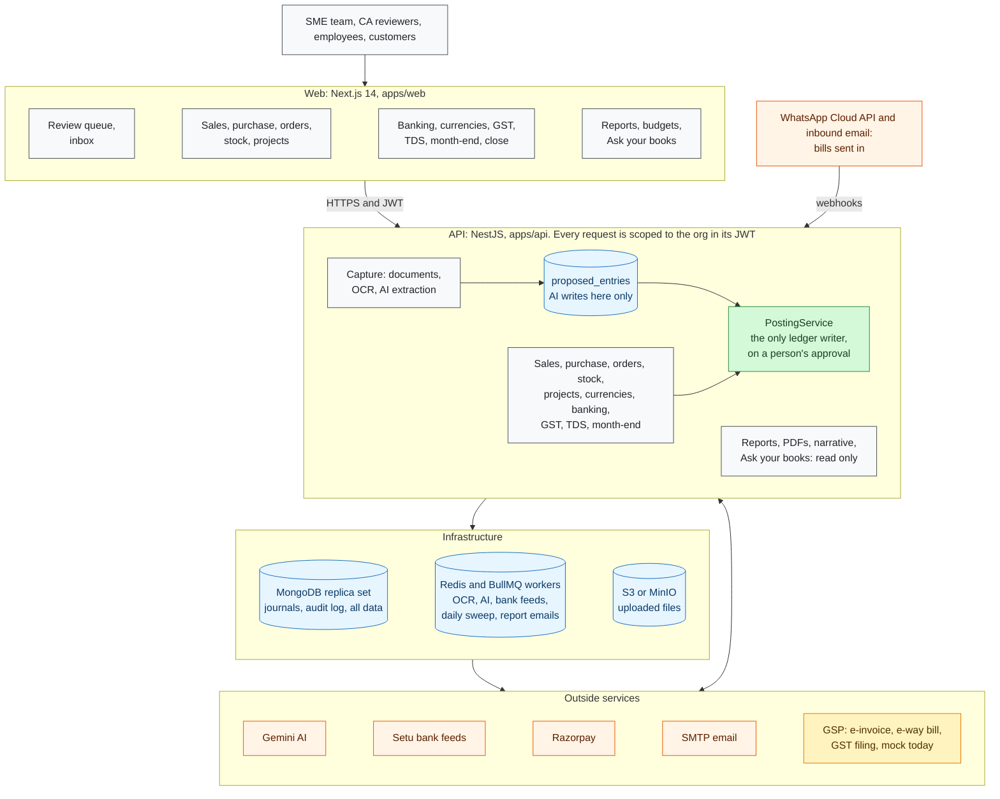
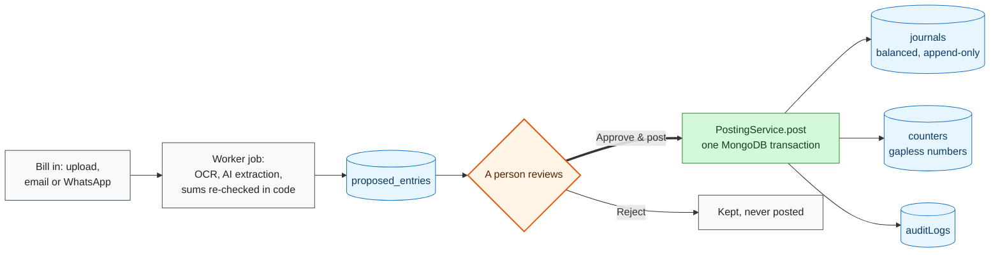

# AI Accounting Platform

AI-first bookkeeping for Indian SMEs and CA firms. Upload the pile — we sort the books.

**Stack:** Next.js 14 + NestJS + MongoDB (replica set) + BullMQ/Redis + S3/MinIO + Gemini

---

## Architecture



**AI suggests, humans commit.** Every document, AI-read or typed, reaches the ledger the same way:



The full, editable diagrams (every module and outside service, the data model by domain, and the year from onboarding to year close, each step marked built, partly built or pending) are in [docs/diagrams/ARCHITECTURE_DIAGRAMS.md](docs/diagrams/ARCHITECTURE_DIAGRAMS.md).

---

## Quick start

### Prerequisites
- Node.js 18+
- pnpm 8+
- Docker + Docker Compose

### 1. Clone and install

```bash
pnpm install
```

### 2. Start infrastructure (MongoDB RS + Redis + MinIO)

```bash
docker-compose up -d
```

> **Why replica set?** MongoDB multi-document transactions — required for atomic posting — only work on a replica set, even in dev. The Docker Compose file starts `mongod --replSet rs0` and runs `rs.initiate()` automatically.

### 3. Configure environment

```bash
cp apps/api/.env.example apps/api/.env.local
# Edit GEMINI_API_KEY and other values
```

### 4. Run both apps

```bash
pnpm dev
```

- Web: http://localhost:3000
- API: http://localhost:3001/api/v1
- Health: http://localhost:3001/api/v1/health
- MinIO console: http://localhost:9001 (minioadmin / minioadmin)

---

## Manual MongoDB replica set setup (without Docker)

If running `mongod` directly:

```bash
# 1. Start mongod with --replSet flag
mongod --replSet rs0 --port 27017 --dbpath /data/db

# 2. In a separate terminal, connect and initiate the RS
mongosh
> rs.initiate({ _id: "rs0", members: [{ _id: 0, host: "localhost:27017" }] })

# 3. Verify
> rs.status()
```

Your connection string must include `replicaSet=rs0`:
```
mongodb://localhost:27017/ai_accounting?replicaSet=rs0&directConnection=true
```

---

## Project structure

```
ai-accounting-platform/
├── apps/
│   ├── api/          NestJS API (port 3001)
│   └── web/          Next.js 14 App Router (port 3000)
├── packages/
│   └── shared/       Shared TypeScript types and DTOs
├── scripts/          DB init scripts
├── docker-compose.yml
├── CLAUDE.md         Non-negotiable invariants for every build session
└── turbo.json        Turborepo pipeline config
```

---

## 8 Invariants (enforced in code — see CLAUDE.md)

1. **Money = integer paise** — never floats, never rupees in the DB
2. **Double-entry, balanced** — `Σ debit = Σ credit`, enforced by Mongoose hook
3. **Append-only journals** — posted journals cannot be mutated; reverse with contra entry
4. **AI suggests, humans commit** — AI writes to `proposedEntries` only, never `journals`
5. **Server-side tenant isolation** — `orgId` from JWT via AsyncLocalStorage, never from client
6. **Universal audit logging** — who/what/when/before/after on every change
7. **Gapless numbering** — voucher numbers via `counters` collection inside the posting transaction
8. **MongoDB as replica set** — transactions require RS; never run standalone in any environment

---

## Build phases

See `AI_ACCOUNTING_BUILD_PLAYBOOK_MONGODB.md` for the full 19-phase build playbook.

| Done | Phase | Description |
|------|-------|-------------|
| ✅ | 0 | Foundation — monorepo, scaffold, CLAUDE.md, design tokens |
| ⬜ | 1 | Tenancy & isolation |
| ⬜ | 2 | Auth & 2FA |
| ⬜ | 3 | RBAC & permission matrix |
| ⬜ | 4 | General Ledger backbone |
| ⬜ | 5–19 | … |

---

## Scripts

```bash
pnpm build        # Build all packages
pnpm dev          # Run all apps in watch mode
pnpm lint         # Lint all packages
pnpm test         # Run all tests
pnpm format       # Format all files with Prettier
```
