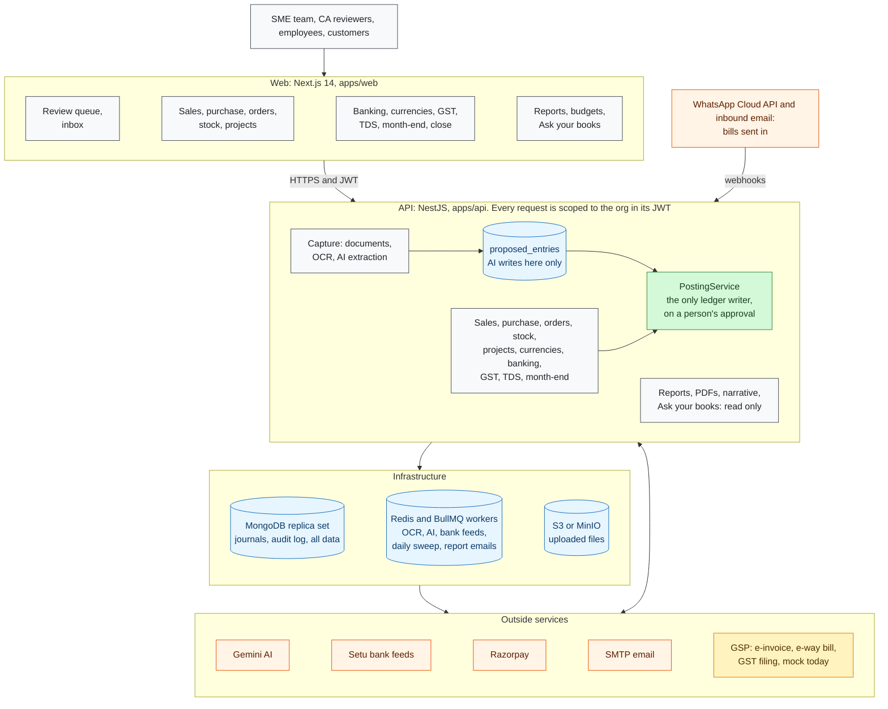
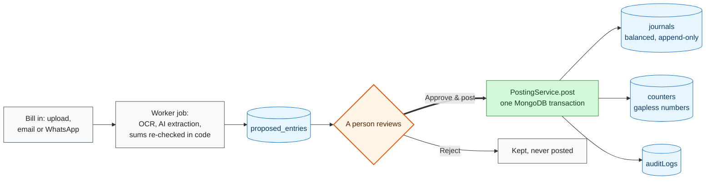

# AiBooks: AI accounting for Indian SMEs and CA firms

AiBooks keeps double-entry books for an Indian business. It reads the bills, invoices and bank statements you send it (by upload, email or WhatsApp), proposes the entries, and a person approves them. Around that core it runs sales and purchase, GST and TDS returns, banking, stock, projects, foreign currency, month-end and year-end, management reports, and a practice-management side for CA firms.

**Using AiBooks?** Read the [user guide](docs/USER_GUIDE.md): every screen, from signing up to closing the year.

**Stack:** Next.js 14 · NestJS · MongoDB (replica set) · BullMQ on Redis · S3 or MinIO · Gemini

---

## Contents

- [What it does](#what-it-does)
- [How the books stay right](#how-the-books-stay-right)
- [Architecture](#architecture)
- [Run it locally](#run-it-locally)
- [Configuration](#configuration)
- [Project structure](#project-structure)
- [Development and tests](#development-and-tests)
- [Documentation](#documentation)
- [Build phases](#build-phases)

---

## What it does

| Area | What a user gets |
|---|---|
| **Capture** | Bills, invoices, receipts and statements by upload, a per-business email address, or WhatsApp. OCR and AI read each one; a person approves it in the review queue. |
| **Review and approvals** | One queue for everything AI proposes, with the reason for each account and checks for duplicates, wrong GSTINs and blocked credit. Maker-checker approval policies with a risk score. |
| **Sales** | Customers, GST invoices with PDF and email, e-invoice and e-way bill, receipts across many invoices with AI allocation, advances, refunds, credit notes, Razorpay payment links and a customer portal |
| **Quotes and orders** | Quotes (drafted by AI from a customer's message), sales orders, delivery challans, purchase orders, goods received and the 3-way match |
| **Purchase** | Vendors with bank details and MSME status, bills, debit notes, payments, and payment runs that put MSME and overdue bills first |
| **Expense claims** | Employee claims, approved by someone else, posted by an accountant, reimbursed |
| **Items and stock** | Item master with AI HSN/SAC suggestions; stock from bills and invoices at weighted-average cost; bill-line to item linking; reorders; the closing-stock entry |
| **Projects** | Projects and timesheets, invoices drafted from unbilled time, profit by project |
| **Foreign currency** | Export invoices under LUT and foreign bills, payments with the realised exchange gain or loss, month-end revaluation |
| **Banking** | Statement import, AI reconciliation, Account Aggregator bank feeds, transfers |
| **GST and TDS** | GSTR-1 and GSTR-3B with filing through a GSP, GSTR-2B reconciliation with each mismatch explained, ITC rules, GSTR-9, Form 26Q, Form 26AS matching |
| **Month-end and close** | A month-end assistant, accruals and prepaids, the fixed-asset register and depreciation, period locks, year-end close |
| **Reports** | The statutory reports, management reports and comparisons, budgets, PDF and CSV, scheduled email, the monthly narrative, and "Ask your books" |
| **CA firms** | Clients, the compliance calendar, document checklists, tasks, leads, fee billing, a support agent, white-label portal |

Some outside connections run in test mode until configured: the GSP, outgoing WhatsApp and SMS, and the bank feed. See [Build phases](#build-phases) for what is not done yet.

---

## How the books stay right

Eight rules hold in the code whatever the feature; [`CLAUDE.md`](CLAUDE.md) has them in full.

1. **Money is integer paise**, never floats.
2. **Every journal balances.** A schema hook refuses one whose debits and credits differ.
3. **Posted journals are never changed.** Corrections are reversing entries.
4. **AI suggests, people commit.** AI writes only proposals; `PostingService.post()`, on a person's approval, is the only writer to the ledger.
5. **Each organisation sees only its own data,** with `orgId` taken from the signed token and applied to every query.
6. **Every change is audited:** who, when, before and after.
7. **Voucher numbers have no gaps,** allocated in the same transaction as the posting.
8. **MongoDB runs as a replica set,** because posting needs multi-document transactions.

---

## Architecture



**AI suggests, humans commit.** Every document, AI-read or typed, reaches the ledger the same way:



The full, editable diagrams (every module and outside service, the data model by domain, and the year from onboarding to year close, each step marked built, partly built or pending) are in [docs/diagrams/ARCHITECTURE_DIAGRAMS.md](docs/diagrams/ARCHITECTURE_DIAGRAMS.md).

---

## Run it locally

### With Docker

**You need:** Node.js 18 or later, pnpm 8, and Docker.

1. **Install the packages:**
   ```bash
   pnpm install
   ```
2. **Start MongoDB, Redis and MinIO:**
   ```bash
   docker compose up -d
   ```
   MongoDB starts as replica set `rs0` on port **27019**, Redis on 6379, MinIO on 9000 (console on 9001).
3. **Configure the API:**
   ```bash
   cp apps/api/.env.example apps/api/.env.local
   ```
   Set `GEMINI_API_KEY`, and the two JWT secrets to long random strings. The rest can stay as it is to start. See [Configuration](#configuration).
4. **Run both apps:**
   ```bash
   pnpm dev
   ```
   - Web: http://localhost:3000
   - API: http://localhost:3001/api/v1 (health check at `/api/v1/health`)
   - MinIO console: http://localhost:9001 (`minioadmin` / `minioadmin`)
5. **Open http://localhost:3000/auth/signup** and create an account. You become the Company admin of a new business. The [user guide](docs/USER_GUIDE.md) takes it from there.

### Without Docker

Any MongoDB 7 or 8 works, as long as it runs as a replica set:

```bash
mongod --replSet rs0 --port 27017 --dbpath /data/db
mongosh --port 27017 --eval 'rs.initiate({ _id: "rs0", members: [{ _id: 0, host: "localhost:27017" }] })'
```

Use a connection string with `replicaSet=rs0`, for example `mongodb://localhost:27017/ai_accounting?replicaSet=rs0&directConnection=true`. A standalone `mongod` will not do: posting fails without transactions.

You also need Redis 5 or later (6.2 recommended) for BullMQ. Without S3 or MinIO, set `STORAGE_DRIVER=local` and `STORAGE_LOCAL_DIR` to a folder for uploaded files.

Then build and start each app:

```bash
cd apps/api && npx nest build && node dist/main
cd apps/web && npx next dev -p 3000
```

Variables set in the shell override `.env.local`, which is handy for pointing at a different database or Redis.

---

## Configuration

The API reads `apps/api/.env.local`; [`apps/api/.env.example`](apps/api/.env.example) lists every variable with comments. The web app needs only `NEXT_PUBLIC_API_URL` if the API is not at `http://localhost:3001/api/v1`.

| Variables | Needed for | Without them |
|---|---|---|
| `MONGODB_URI` | Everything. Must be a replica set. | The API does not start |
| `REDIS_HOST`, `REDIS_PORT` | Background jobs: reading documents, AI, bank feeds, the daily sweep, report emails | The API does not start |
| `JWT_ACCESS_SECRET`, `JWT_REFRESH_SECRET` (and `JWT_RESET_SECRET`) | Sign-in tokens and password resets | Set long random values in every environment |
| `PORT`, `API_URL`, `WEB_URL` | Where the API listens, and links in emails | Defaults to 3001 and localhost |
| `GEMINI_API_KEY` (optional `GEMINI_EXTRACTION_MODEL`, `GEMINI_VISION_MODEL`) | Reading documents and every AI feature | Documents are not read; Ask your books and the narrative fall back to rules |
| `STORAGE_DRIVER` (`auto`, `s3` or `local`), `STORAGE_LOCAL_DIR`, `S3_ENDPOINT`, `S3_REGION`, `S3_BUCKET`, `S3_ACCESS_KEY`, `S3_SECRET_KEY` | Where uploaded files are kept | `auto` falls back to local disk when S3 is unreachable |
| `SMTP_HOST`, `SMTP_PORT`, `SMTP_USER`, `SMTP_PASS`, `FROM_EMAIL` | Invoice email, password resets, scheduled report emails | Nothing is emailed, and the screens say so |
| `GOOGLE_CLIENT_ID`, `GOOGLE_CLIENT_SECRET`, `GOOGLE_CALLBACK_URL` | Continue with Google | Email and password only |
| `INBOUND_EMAIL_DOMAIN`, `INBOUND_EMAIL_SECRET` | Each business's bills-by-email address | Email-in shows as not set up |
| `WHATSAPP_VERIFY_TOKEN`, `WHATSAPP_APP_SECRET`, `WHATSAPP_ACCESS_TOKEN`, `WHATSAPP_GRAPH_VERSION`, `WHATSAPP_BUSINESS_NUMBER` | Bills sent in on WhatsApp (Meta Cloud API) | WhatsApp-in shows as not set up |
| `RAZORPAY_KEY_ID`, `RAZORPAY_KEY_SECRET`, `RAZORPAY_WEBHOOK_SECRET` | Payment links on invoices | Test links that take no money |
| `BANK_FEED_PROVIDER` (`mock` or `setu`), `SETU_AA_*` | Bank feeds through Setu's Account Aggregator | A test bank with made-up transactions |
| `GSP_PROVIDER` | E-invoice, e-way bill and GST filing | Only `mock` exists today: nothing reaches the portals |

`GROQ_API_KEY` is in the example file but no module uses it; every AI call goes to Gemini.

---

## Project structure

```
apps/
  api/                NestJS API, port 3001, base path /api/v1
    src/
      gl/ journals/ audit/      The ledger: accounts, PostingService, vouchers, reversals, the audit log
      documents/ ocr/ extraction/ proposals/ inbound/ ingest/ attachments/ ai-suggestions/
                                Capture, the review queue, and AI advice
      sales/ purchase/ payments/ portal/ orders/ items/ stock/ projects/ currency/ expenses/
      banking/ bank-feeds/ gst/ einvoice/ gsp/ tds/
      month-end/ closing/ approvals/ automation/ reports/ insights/ exports/ migration/
      auth/ tenancy/ org-settings/ platform-admin/   Sign-in, roles, organisations
      crm/ workspace/ white-label/                   The CA-firm practice side
    test/             Jest global setup: an in-memory MongoDB replica set
  web/                Next.js 14 App Router, port 3000
    src/app/(app)/    One folder per screen; src/components holds their parts
packages/
  shared/             Types, enums and roles shared by both apps
docs/                 User guide, diagrams, the build plan and the design system
docker-compose.yml    MongoDB replica set, Redis and MinIO for local development
CLAUDE.md             The rules every change must keep
```

Each API domain is one NestJS module: its Mongoose schemas in `schemas/`, the logic in services, thin controllers, and pure functions in their own files so they can be tested without a database. OCR and every AI call run as BullMQ jobs, never inside a request.

---

## Development and tests

From the repository root:

```bash
pnpm dev            # both apps in watch mode
pnpm build          # build everything
pnpm test           # every test suite
pnpm lint           # lint
pnpm format         # Prettier
```

- **API tests** run against a real MongoDB replica set, never a mock. Jest's global setup starts an in-memory one (`mongodb-memory-server`) and each spec file gets its own database. The suite has 99 spec files and 872 tests.
- **One spec:** `cd apps/api && npx jest src/stock/stock.service.spec.ts`
- **Type-check:** `npx tsc --noEmit -p apps/api/tsconfig.json` and `npx tsc --noEmit -p apps/web/tsconfig.json`

Before changing anything, read [`CLAUDE.md`](CLAUDE.md): the eight rules above, the code conventions, and the design-system reminders. A feature that cannot be built without breaking a rule changes; the rule does not.

---

## Documentation

| Document | For |
|---|---|
| [User guide](docs/USER_GUIDE.md) | Everyone using AiBooks: every screen, step by step |
| [Architecture diagrams](docs/diagrams/ARCHITECTURE_DIAGRAMS.md) | The system map, the data model by domain, and the year from onboarding to close, with what is built |
| [End-to-end workflow and AI plan](docs/END_TO_END_WORKFLOW_AND_AI_PLAN.md) | The nine phases and the rules every AI feature follows |
| [Platform build spec](docs/AI_ACCOUNTING_PLATFORM_BUILD_SPEC.md) | Architecture, data model and the document pipeline |
| [Design system](docs/AI_ACCOUNTING_DESIGN_SYSTEM.md) | Colours, type, copy and page specs |
| [Build playbook](docs/AI_ACCOUNTING_BUILD_PLAYBOOK_MONGODB.md) | How the core platform was built |

---

## Build phases

The core platform (tenancy, auth, roles, the ledger and the document-to-proposal pipeline) follows the build playbook in [docs/AI_ACCOUNTING_BUILD_PLAYBOOK_MONGODB.md](docs/AI_ACCOUNTING_BUILD_PLAYBOOK_MONGODB.md). On top of it, the nine phases of the [end-to-end workflow and AI plan](docs/END_TO_END_WORKFLOW_AND_AI_PLAN.md) are built:

| Done | Phase | What it added |
|------|-------|---------------|
| ✅ | 1 | Finish what was half-built: party and account editing, opening balances by hand, TDS screens, the audit trail, transfers with AI detection, invoice PDF and email, AI duplicate, fraud and blocked-ITC checks on bills |
| ✅ | 2 | Money in and out: advances, one receipt across many invoices with AI allocation, refunds, vendor bank details and MSME, payment runs with an AI suggestion, Razorpay links and the customer portal |
| ✅ | 3 | Capture from everywhere: bills by email and WhatsApp, attachments on any record, the Setu account-aggregator bank feed |
| ✅ | 4 | Compliance: item master with AI HSN/SAC, e-invoice and e-way bill through a GSP with an AI pre-check, GST filing, GSTR-2B and ITC rules, GSTR-9, Form 26Q and the 26AS match |
| ✅ | 5 | Month-end: recurring journals, accruals and prepaids, the fixed-asset register and depreciation, the month-end assistant |
| ✅ | 6 | Orders and approvals: quotes drafted from a message, sales orders and challans, purchase orders, goods received and the 3-way match, approval policies with maker-checker and a risk score, expense claims |
| ✅ | 7 | Stock: moves and weighted-average valuation, line-to-item linking, reorders, the opening and closing stock entries |
| ✅ | 8 | Reports and answers: management reports, comparisons and budgets, any report as PDF or CSV and by scheduled email, the AI monthly narrative, Ask your books |
| ✅ | 9 | Projects and currencies: projects and timesheets with invoices drafted from time, foreign-currency documents with realised and unrealised exchange, exports under LUT in the returns |

**Not done yet**
- A real GSP: e-invoice, e-way bill and GST filing run end to end against a mock adapter only.
- Outgoing WhatsApp and SMS: payment reminders and CRM messages go through a test provider. Invoice email over SMTP is real.
- Exports with payment of IGST, and e-invoices for exports: exports are supported under LUT only.
- Form 27Q and the FVU file for 26Q; GSTR-9 is computed but not filed.
- Stock in more than one warehouse; credit and debit notes as stock moves (returns are entered as adjustments).
- Exchange rates are entered by hand; there is no RBI or FBIL feed.
