# Architecture diagrams

Three pictures of the platform as the code stands on `feat/phase-1` (4 November 2026, commit `744a64c`): how the parts connect, what the database holds, and an accounting year from signup to year close.
They were drawn from `apps/api/src` and `apps/web/src` and checked against [the workflow and AI plan](../END_TO_END_WORKFLOW_AND_AI_PLAN.md). The plan's status marks were written before most of the building, so trust the marks here instead.
Each diagram is a plain Mermaid block, which GitHub and the VS Code Markdown preview both render. Edit them by hand. To change a box's status, change its `:::class`.

## Legend

| Status | Meaning | How it is drawn |
|---|---|---|
| **Built** | In the code on `feat/phase-1`, with tests | Green box, `:::built` |
| **Partly built** | Code exists, but part of what the plan promises is missing. The box says what. | Amber box, `:::partly` |
| **Pending** | Planned, with no code yet | Grey dashed box, `:::pending` |

The ER diagrams in section 2 can't colour entities, so they use a naming rule instead (see 2.0).

**Judgement calls behind the marks**

- **GSP.** E-invoice, e-way bill and GST filing are complete end to end, but `gsp/gsp.module.ts` has only `MockGsp`, and any other `GSP_PROVIDER` value stops the API. So every step that reaches a government portal is marked partly built.
- **Stock (Phase 7).** The API (`2a929f7`) and the `/stock` page (`744a64c`) are in, so stock is marked built. Two gaps remain: the closing checklist doesn't ask for the closing-stock entry yet (the Month-end assistant shows it), and credit and debit notes aren't read as stock moves (returns are entered as adjustments). Year close stays partly built for the first.
- **Sending messages.** Invoice email goes out over SMTP. Payment reminders and CRM messages are written and scheduled, but every channel goes through `MockMessagingProvider`, so nothing reaches the customer by WhatsApp or SMS.
- **AI provider.** Every model call goes to Gemini (`@google/generative-ai`). `groq-sdk`, `GroqVisionService` and `GroqExtractionService` are present, but no module provides them.
- **Razorpay and Setu.** Both are real adapters. Each falls back to a test provider when its keys or `BANK_FEED_PROVIDER` aren't set. Marked built.

---

## 1. System architecture

### 1a. The map: every module, store and outside service

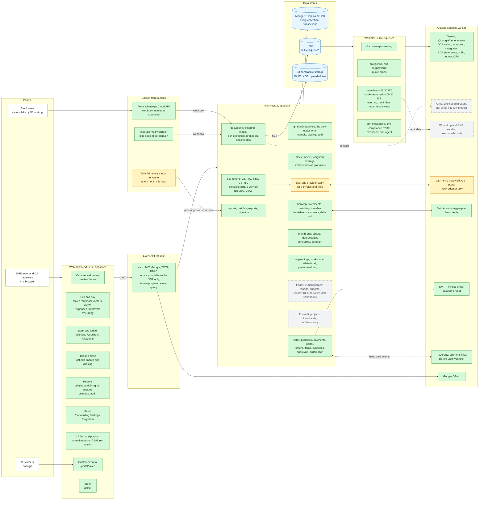

### 1b. The key flow: from a bill to the ledger

AI writes only to `proposed_entries`. A journal is written only by `PostingService.post()`, inside one MongoDB transaction, and only after a person acts.

```mermaid
flowchart LR
  classDef built fill:#D3F9D8,stroke:#2B8A3E,color:#1B3D24
  classDef partly fill:#FFF3BF,stroke:#E67700,color:#4D3000
  classDef store fill:#E7F5FF,stroke:#1971C2,color:#0B3A66
  classDef human fill:#FFF4E6,stroke:#E8590C,stroke-width:2px,color:#5C1F00

  subgraph inbox["Step 1 - documents in"]
    up["Upload on /review or /inbox"]:::built
    em["Email to the org's bills address"]:::built
    wa["WhatsApp photo or PDF"]:::built
  end

  docs["documents module<br/>SHA-256 check: a repeat file<br/>is marked DUPLICATE"]:::built
  s3[("S3-compatible storage")]:::store
  queue[("Redis<br/>document-processing queue")]:::store

  %% Spreadsheets skip OCR: their cells are parsed directly by ingest
  subgraph worker["Step 2 - worker job, never inside the request"]
    ocrStep["OCR cascade<br/>tiers 0-1: text in the file<br/>tiers 2-3: Gemini vision"]:::built
    isStmt{"Bank statement?"}
    ext["Extraction: Gemini to strict JSON<br/>money as integer paise,<br/>sums re-checked in code"]:::built
    build["Proposal: bill checks,<br/>account by past choice, rule,<br/>model or default, with a reason"]:::built
  end

  recon["Bank reconciliation<br/>lines matched there"]:::built
  pe[("proposed_entries<br/>status PROPOSED")]:::store
  others["Other proposal sources<br/>unmatched bank lines, GSTR-2B lines,<br/>month-end adjustments"]:::built
  stockSrc["Opening and closing stock entries"]:::built

  subgraph decide["Step 3 - a person decides"]
    review["Review queue<br/>edit lines, then Approve & post"]:::human
    reject["Reject: kept, never posted"]:::built
  end

  typed["Documents people enter<br/>invoices, bills, payments, vouchers,<br/>expense claims, once any approval policy passes"]:::human

  subgraph tx["Step 4 - PostingService.post, one Mongo transaction"]
    checks["Period lock and<br/>account checks"]:::built
    counter["counters: inc seq<br/>gapless per org, type, FY"]:::built
    jr[("journals<br/>balanced, append-only")]:::store
    audit[("auditLogs<br/>append-only")]:::store
  end

  linked["Bill or invoice marked posted,<br/>linked to its journal"]:::built
  learn[("vendor_ledger_maps<br/>learns from corrections")]:::store

  up --> docs
  em --> docs
  wa --> docs
  docs -->|file| s3
  docs -->|job| queue
  queue --> ocrStep
  ocrStep --> isStmt
  isStmt -->|yes| recon
  isStmt -->|no| ext
  ext --> build
  build --> pe
  others --> pe
  stockSrc --> pe
  pe --> review
  review -->|Reject| reject
  review ==>|"Approve & post"| checks
  typed ==> checks
  checks --> counter
  counter --> jr
  jr --> audit
  jr --> linked
  review -.->|"account changed"| learn
```

---

## 2. Data model

### 2.0 How to read these

- Entity names are the real MongoDB collection names, exactly as `@Schema({ collection })` gives them. `auditLogs` and `orgMemberships` really are camelCase.
- **Singular names** such as `journal_line` and `doc_line` are **embedded subdocuments**, not collections.
- Each diagram shows a few key fields, not every field. Money is always an integer number of paise (`*Paise`, typed `int`). `amountsPaise` is the embedded `{ taxableValue, cgst, sgst, igst, cess, total }`, all in paise.
- Every collection except `platforms`, `firms`, `users`, `counters` and the CRM's firm-level collections carries an indexed `orgId`, scoped by the tenant plugin. `orgId` is left out of most boxes to save space.
- A collection that appears again in a later diagram shows only the fields that matter there.
- **Partly built** collections have `PARTLY BUILT` in a `%%` comment and in their first attribute's comment.
- **Planned** collections, and planned fields on existing collections, live only in diagram 2.10. When one is built, move it into its domain diagram.

### 2.1 Tenancy, platform and CA-firm CRM

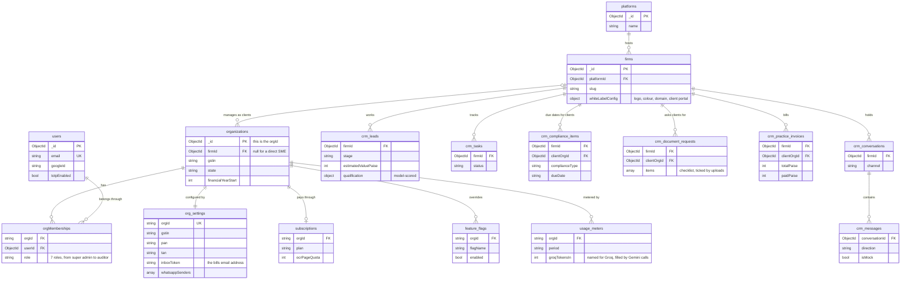

### 2.2 Ledger core

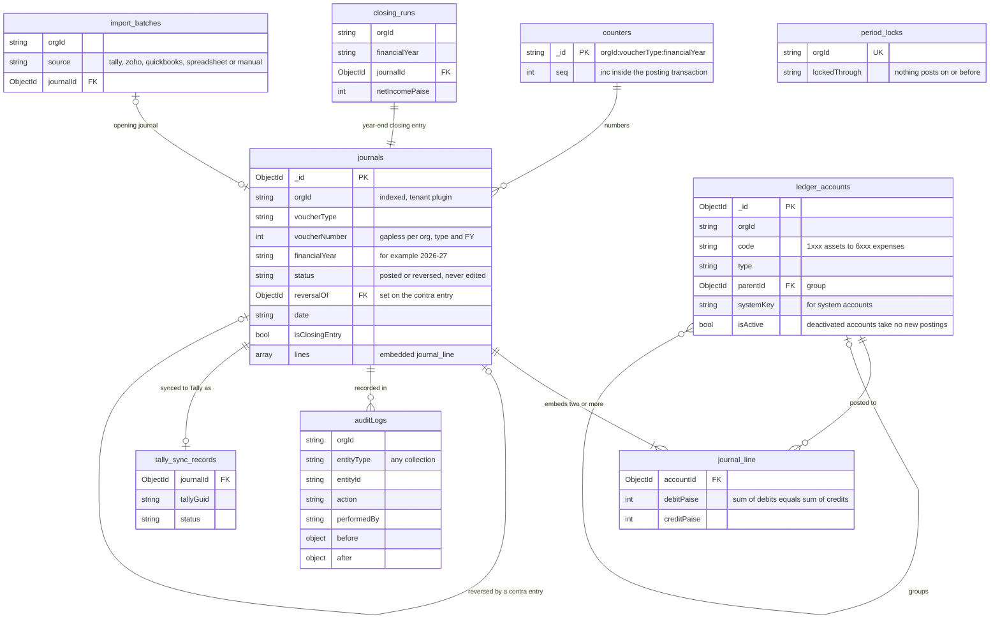

### 2.3 Document pipeline and AI

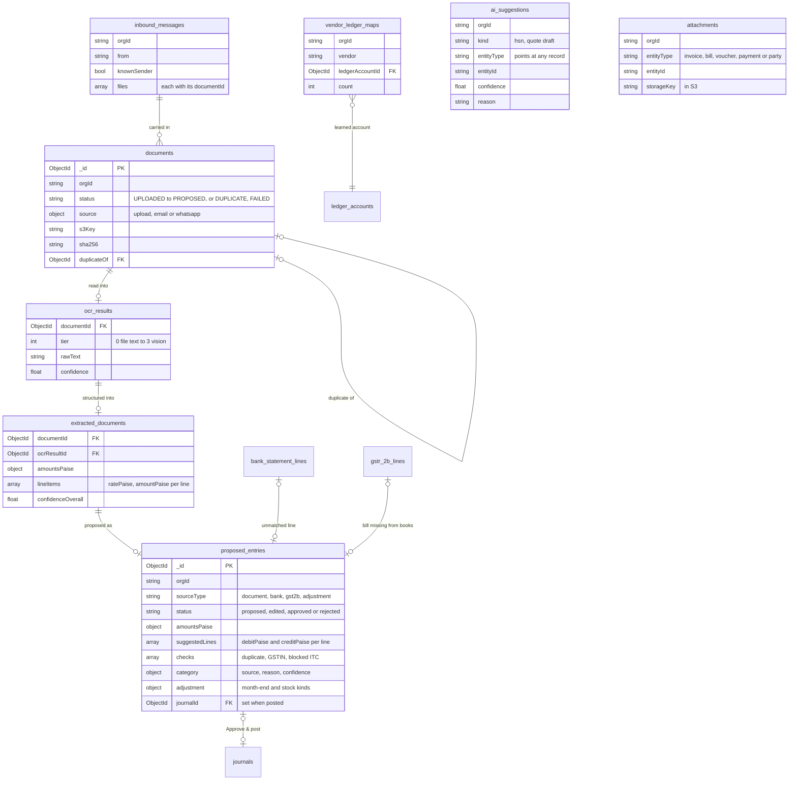

### 2.4 Sales, purchase and payments

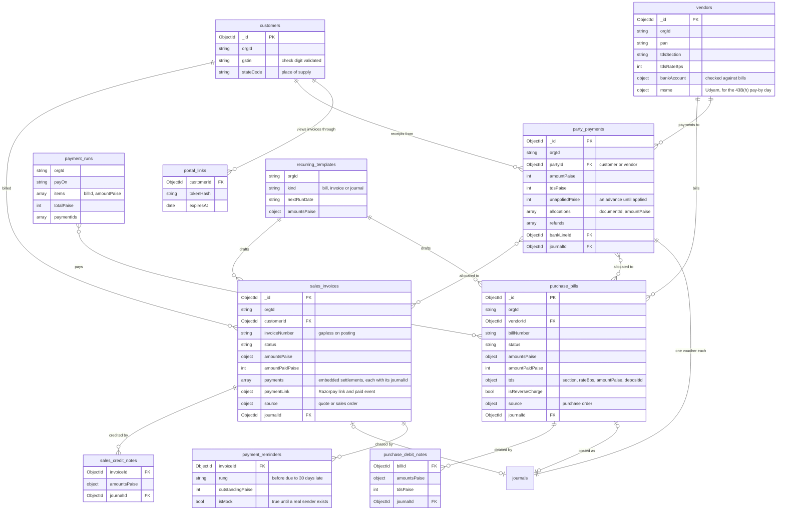

### 2.5 Orders and items

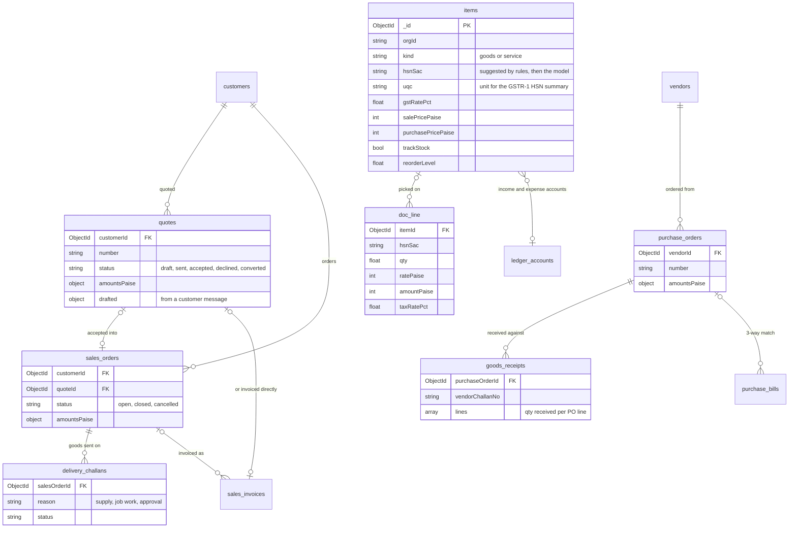

### 2.6 Banking

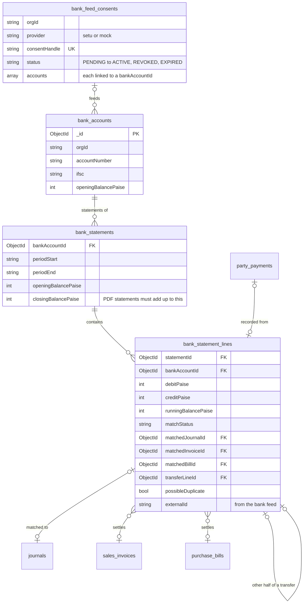

### 2.7 GST and TDS

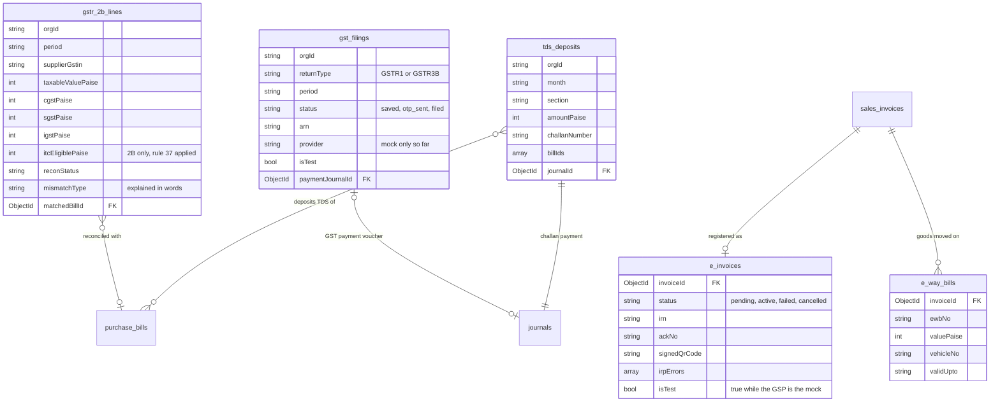

GSTR-9, Form 26Q, the Form 16A summary and the 26AS match are computed when asked for. Nothing is stored for them.

### 2.8 Month-end and stock

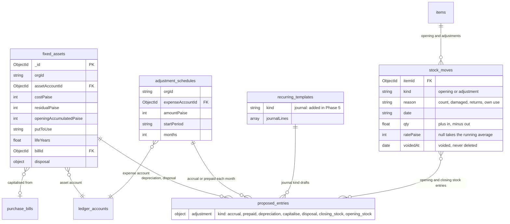

### 2.9 Approvals and expense claims

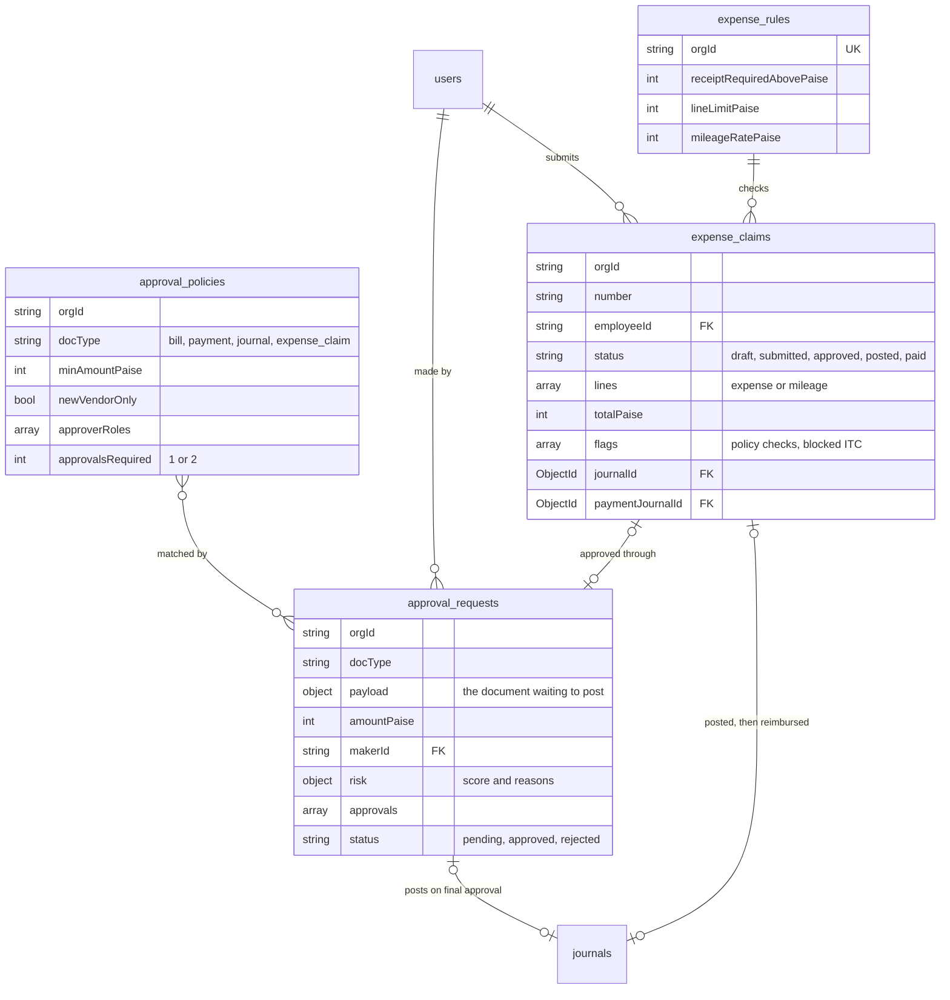

### 2.10 Planned: not in the code yet

Everything below is pending. Existing collections appear here only with the fields the plan would add to them.

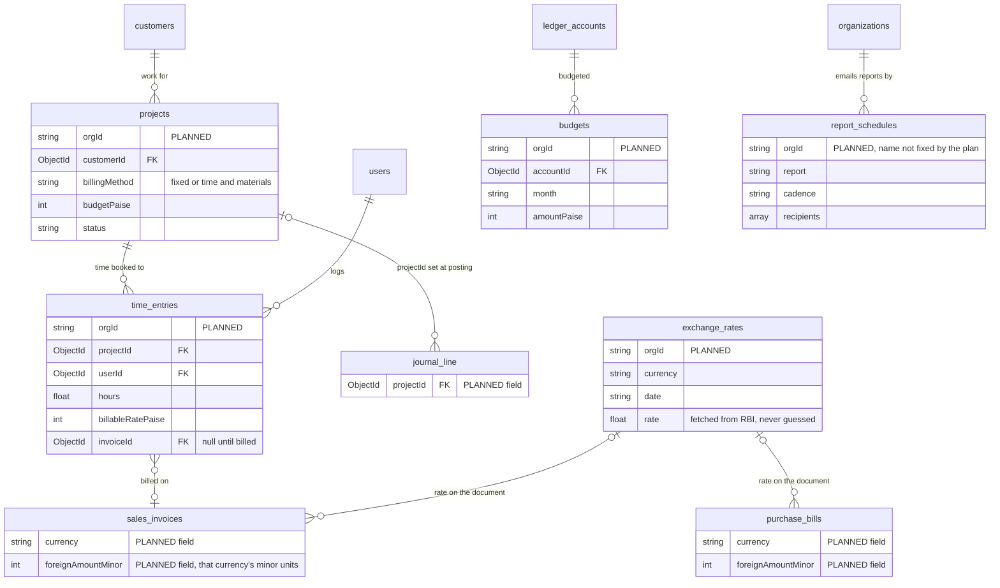

The plan also names `depreciation_runs`. The code doesn't need it: each depreciation run is a `proposed_entries` record with `adjustment.kind = depreciation`. "Ask your books" and the monthly narrative need no new collection. They read reports, and the narrative would be an `ai_suggestions` record.

---

## 3. End-to-end lifecycle

One organisation's year, from signup to year close. Arrows show the usual order. Dotted links join a step to related work that is still missing.

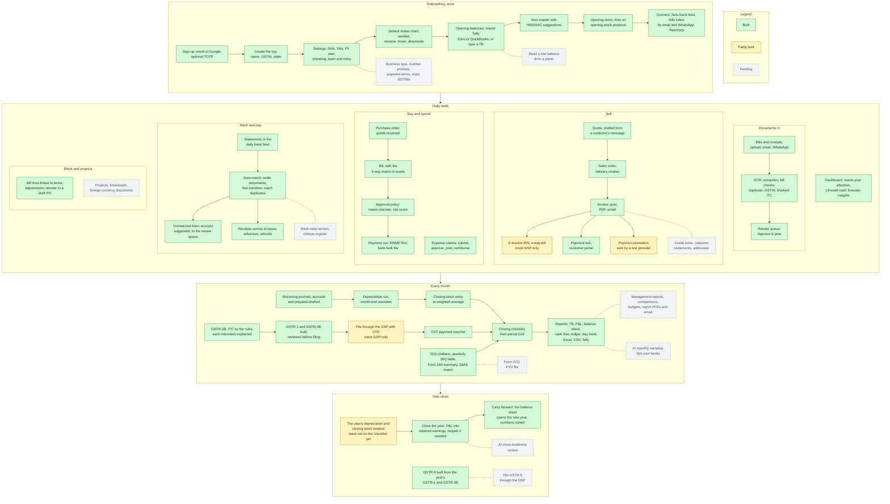
